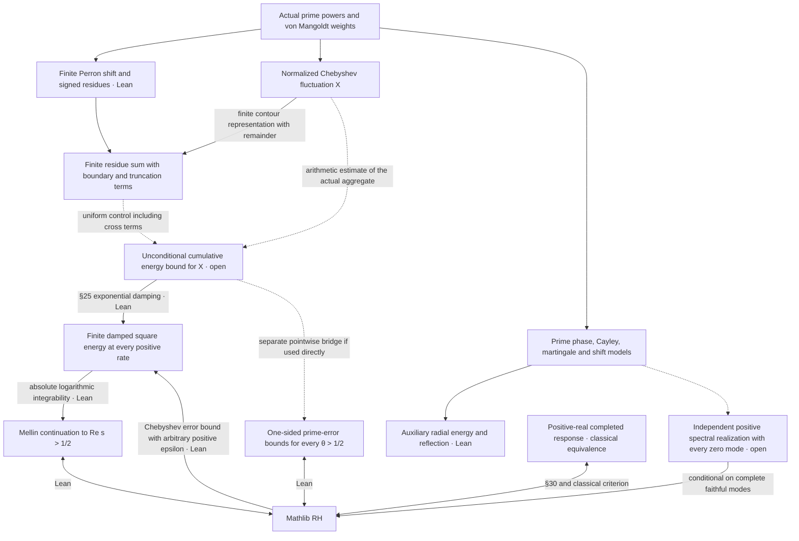

# Version 22 proof audit and dependency graph

The research baseline is version 22, dated 26 November 2026, introduced in commit `0191102`. Round 41 audited the manuscript on `9f0e4e9`, and round 42 verified the §25 implication in Lean. The section numbers below refer to this text. The target is Mathlib's `RiemannHypothesis` for the actual zeta function. The work in the repository supplies the $q=1$ endpoint and finite Perron identities. The paper's reports of external proofs and its numerical tables supply context for this audit. [Version 22 source](../paper/Angles_and_Radii_of_the_Riemann_Zeros.tex)

## Dependency graph

Solid arrows below are implications with the indicated evidence. Dotted arrows mark mathematical obligations. The Mellin route isolates residues analytically and avoids a termwise lower bound on the entire zero sum.

Here $X(u)=e^{-u/2}(\psi(e^u)-e^u)$. The missing estimate is on **this** fluctuation or a proved equivalent arithmetic transform. Round 42 checks the change of variables $x=e^u$ and proves that a cumulative bound $\int_{\log 2}^{L}|X(u)|^2\,du=O(L^k)$ for any fixed nonnegative integer $k$ gives finite damped square energy at every rate $\delta>0$. The proof bounds each unit interval by the cumulative mass through its right endpoint and sums after exponential damping. The inequality $|X|\le 1+X^2$ gives absolute integrability of the logarithmic Mellin integrand. For each point in $\Re s>1/2$, one chooses a positive damping rate smaller than its distance to the critical line, then applies the existing Mellin analyticity theorem. A direct energy-to-pointwise implication needs additional information about the arithmetic fluctuation.

The Lean theorem `riemannHypothesis_iff_chebyshevWave_damped_energy` also gives the reverse direction for damped energy. The existing Chebyshev bound under RH, with exponent $1/2+\delta/4$, makes the damped square bounded on the tail by a constant times $e^{-\delta u/2}$. This converse concerns integrability at each fixed rate. A polynomial cumulative bound would require additional control as the rate tends to zero. In particular, for $L\ge\log 2$, the damping factor $e^{-u/L}$ is at least $e^{-1}$ on $[\log 2,L]$. Thus $\int_{\log 2}^{L}|X(u)|^2\,du\le e\int_{\log 2}^{\infty}|X(u)|^2e^{-u/L}\,du$. A bound of order $\delta^{-k}$ for the damped integral as $\delta\downarrow0$ would supply the polynomial cumulative bound.

The alternative spectral route needs an independent construction from the integers and archimedean data, a positive invariant norm, and a faithful correspondence with every nontrivial zero, including its multiplicity. The arithmetic route can bypass a spectral realization entirely. Neither route needs the precise von Koch logarithmic power for the $q=1$ target.

## Classification

**Lean** means the stated part follows from named declarations in [RiemannResearch.lean](../lean/RiemannResearch.lean). **Known** denotes a classical result or a standard mathematical deduction with its usual hypotheses. **Model** denotes a paper construction or calculation whose stated form is not yet formalized here. **Gap** denotes an unproved claim, missing estimate, or empirical inference. **Circular** marks using an RH-equivalent or RH-assuming statement as an independent premise for RH. **Data** marks finite experiments or externally reported results. A row may contain distinct claims with distinct statuses.

| v22 location | Mathematical claims and status | Role or limitation |
| --- | --- | --- |
| §1 | **Known** finite-field Frobenius interpretation. **Model** applying the circle picture to the integers. | The analogy motivates the question of a number-field realization. |
| §2.1 | **Known** Riemann–Siegel phase and Riemann–von Mangoldt count, with the argument and ordinates at jumps interpreted in the usual convention. **Known** off-line examples with functional-equation symmetry. | A phase law and functional equation allow off-line zeros. |
| §2.2 | **Known** modulus and argument of $b^\rho$, reflection across the circle, and the finite-field period and reciprocal coordinate. **Data** wrapped-angle bins. | The modulus criterion is an encoding of the target. Reflection by itself pairs opposite offsets. |
| §2.3 | **Known** Li's criterion and the unit-circle image. **Model correction** the side-to-region direction for the stated coordinate is reversed, as derived below. | Positivity of all Li coefficients is already an equivalent criterion. |
| §3 | **Known** Weil explicit formula and Gaussian transform, hence Gaussian contributions at prime powers with the stated weights. **Model/Data** reverse trace, tail estimate from density, peak detection and agreement with the finite sample. | A bound from replacing counts by mean density is a numerical estimate unless the replacement error is bounded. The trace equality requires the full test class and zero sum. |
| §4 | **Model** jitter, random null, synthetic reflected pairs, and $\cosh(\delta t)$ envelopes at fixed heights. **Known** classical amplitude and oscillation results. **Gap** turning a single-mode envelope into a bound for the total. | Synthetic reflected pairs allow off-line modes. A finite observation window cannot exclude arbitrarily small offsets. |
| §5 | **Known** unfolding, pair correlation in its proved range, and Landau's fixed-$x$ sum. **Data/Gap** finite GUE comparisons and unproved general spacing assertions. | A real-ordinate cosine average uses the critical-line restriction. Prime powers include composite prime powers, so the final comparison should say bases that are not prime powers. |
| §6 | **Known** pole terms, archimedean contribution, trivial zeros, Mellin convolution and Weil's full positivity equivalence. **Data** background table. **Circular** treating full Weil positivity as already supplied by symmetry or finite checks. | The reflected-pair term is a cross product. The sign of the full form requires all modes and admissible tests. |
| §7 | **Known** Hlawka equidistribution and cited refinements for wrapped heights. **Data/Gap** finite bins and Poisson-like local gaps. | Equidistribution controls a marginal law and does not imply a spacing law or identify radii. |
| §8 | **Known/Model** Fourier transforms, explicit-formula matrix and conditional Gram positivity. **Data** near-null eigenvectors and ordinate recovery. **Gap** full-space coercivity or absence of a gap in a specified norm. | Finite numerical positivity and agreement with a zero sample leave the uniform theorem open. The conclusion's gap language must retain §8's qualification. |
| §9 | **Known** classical annulus criterion and Frobenius trace formula. **Lean** the critical exponent case with every positive epsilon, from RH and back via the one-sided criterion. **Known/Model** generating-function argument for a finite spectrum and reflected roots of (T^2-7T+7). **Data** finite turning. | Positive integral counts with divisibility can coexist with off-circle roots. The uniform amplitude bound, including cancellation, is the input that forces the radius. |
| §10 | **Known** finite-field Stepanov argument, degree bound and Frobenius identities. **Model/Data** the explicit linear systems and tested auxiliary polynomials. **Gap** nonvanishing for parameter-count-only examples and an integer analogue. | A nonzero vector of coefficients need not give a nonzero auxiliary polynomial. |
| §11 | **Data** reported quasi-Riemann estimates and comparison-system optimality. **Model** algebraic reproduction of the stated recursion and fixed point. | The external analytic arguments and announcements are not premises of the local proof. |
| §12 | **Known** cited spectral realizations in their own spaces. **Model** requirements for a new operator. **Gap** a natural positive realization, spectral mapping with proper domain/completeness, and any GUE conclusion. | Exponentiating actual eigenvectors is valid when the operator is defined on them. An unrestricted assertion about the full spectrum of an infinite-dimensional semigroup needs separate hypotheses. Exact trace identity is not a proof of GUE. |
| §13 | **Known** rational independence of prime logarithms and finite-dimensional phase density. **Data/Gap** approximate return times and high-dimensional extrapolation. | Approximate periods do not yield exact identities or derivative vanishing. |
| §14 | **Known** one-prime geometric/logarithmic series and Euler-product absolute convergence for $\sigma>1$. **Data/Gap** finite critical-line behaviour and any inference of continuation or control from that truncation. | The pole accounts for a main term, and does not provide a general cancellation estimate. |
| §15 | **Known** character orthogonality as a sum over residue classes and the positive-weight amplifier inequality. **Data** concentration around the diagonal. **Gap** uniform off-diagonal cancellation. | The criterion for exact equality is zero **net** cross term. Collision-free labels are sufficient. The `LP<q` rule needs the actual prime-power cutoff and product multiplicities, as explained below. |
| §16 | **Known** Landau–Page and the cited low zero for $q=163$. **Data/Gap** extremes and discrimination of slow waves from off-line growth. | Small finite-window error or a rare outlier does not identify a zero's real part. |
| §17 | **Known** zero counts, de Bruijn–Newman threshold, Rodgers–Tao, and Lee–Yang under ferromagnetic hypotheses. **Data** sign-change computations and finite-cluster flow. **Gap** full-flow extrapolation, general small-gap heuristic and an arithmetic Lee–Yang contraction. | Palindromic symmetry survives off-circle Ising examples. The heat-flow theorem alone does not force real zeros at $t=0$. |
| §18 | **Data/Gap** observed amplification and projected infinite-dimensional conclusions. | A uniform estimate for off-diagonal terms remains missing. No implication from those experiments to the quasi-Riemann exponent or to RH is used. |
| §19 | **Data** paper's reports about external verification and its interpretation of the unsigned guide. | No external theorem export or checker run was independently audited here. The reported theta-lift, slope and Iwasawa inputs are excluded from the dependency graph. |
| §20 | **Lean** $q=1$ one-sided criterion in both directions, including pole signs, Landau step and reflection. **Known** character orthogonality and the classical family argument; the $q>1$ formalization and sharp von Koch bound are outside the current target. **Model/Data** chain-cost optimization, finite comparisons and toy arithmetic engines. **Gap** a bound from the actual integers. | The criterion consumes the bound. Toy linear multiplicity is not a bound on the original statistic. |
| §21 | **Known** Legendre, Stirling, binomial valuations, factorial Chebyshev identity and Möbius inversion. **Model/Gap** optimizing the proposed $x/M+M\log x$ budget. | The proposed budget is an input. Möbius signs survive the factorial rewriting. |
| §22 | **Known/Model** Möbius phase and parity projections, even Fejér filter, phase Euler product and endpoint identities. **Known** square-free count and classical Mertens criterion. **Circular** the critical-exponent error for the positive endpoint combination is equivalent to Mertens cancellation. | The leading square-free term is nonnegative but subtracting it leaves the original difficulty. |
| §23 proposition | **Known/Model** finite ratio, meromorphic ratio $\zeta(2s)/\zeta(s)^2$, Hilbert–Schmidt threshold, nonvanishing regularized factors and the odd-power series extending to $\Re s>1/3$. **Gap/Circular** independent control of the removed $P(s)$. | The quadratic determinant leaves out exactly the first-order term tied to zeta zero singularities. Finite `det(U*U)>0` is automatic for invertible $U$. |
| §24 | **Known/Model** finite orthogonality and Besicovitch convergence of prime sums and fixed derivatives. **Gap** local limit or transform information. | Taking the long-time average at fixed cutoff does not commute with the uniform finite-window limit needed for the actual fluctuation. |
| §25 proposition and preceding identities | **Model** damped oscillator identity for a prescribed mode. **Known** unitary translations with continuous spectrum and no (L²) eigenfunctions. **Lean** strict nonconservation for a reflected off-line pair, exact finite Perron residue normalization, the cumulative energy implication to RH, and equivalence of damped square integrability at every positive rate with RH. **Gap** the unconditional cumulative bound for actual $X$. | Translation and positive energies of prescribed modes supply no bound on the full arithmetic fluctuation. A separate arithmetic estimate must establish the energy criterion. |
| §26 proposition | **Known/Model** multinomial moment formula, $m!$ bound, fourth moment, and fixed-$m$ Besicovitch convergence. | Unique factorization selects exact resonances for any RH status. It gives no uniform finite-window estimate. |
| §27 | **Known/Model** sinc kernel, (N^{-m}) separation bound and reference-density subtraction. **Gap** cutoff-uniform near-resonance and signed residual-energy control. | Reference subtraction does not preserve positivity as an order property. Independent estimates of the actual residual are needed. |
| §28 proposition | **Known/Model** hyperbolic invariant and indefinite metric; the positive invariant metric exists exactly at zero offset. **Lean** direct strict growth of the positive sum under a nonzero offset. **Circular** imposing the positive metric on the actual zero modes without independent construction. | A positive metric for the diagonal model determines the offset by an elementary diagonal entry. |
| §29 | **Known** Bochner/RKHS implications under continuity and positive definiteness. **Model** prime-log correlation kernel. **Gap** common realization or pole correspondence with all zeta zeros. | Its Bochner support is the prime logarithms. Membership of a positive measure on a real frequency space alone has no implication for a different spectrum. |
| §30 proposition | **Known** odd completed logarithmic derivative, paired Hadamard expansion with multiplicity, positive-real criterion and RH-conditional Gram representation. **Lean** analogous local logarithmic derivative pole calculation for zeta and arithmetic `−ζ′/ζ` identity in the convergent half-plane. **Circular** importing global positive real part or the RH-conditional Gram representation into the converse. | A true off-line zero yields a real-part sign failure near its pole. A proof must derive passivity for the completed function without assuming a real-ordinate representation. |
| §31 | **Known** free abelian valuations, compact product characters, dense finite projections and Haar orthogonality. | All hold without conditions on zeros. |
| §32 | **Known/Model** contractive prime factors, Cayley positivity and reciprocal-prime summability threshold. | The threshold comes from $p^{-2\sigma}$ and the prime series. No spectral restriction follows. |
| §33 | **Known/Model** finite positive sums, divergence of the infinite background and normal convergence after removing linear terms. **Gap** passivity-preserving composition and identification of the completed response. | Even at one prime the subtraction can make the real part negative. |
| §34 | **Known/Model** pointwise unitary dilation, two-port formula, independent product, Poisson-kernel martingale, second moments and their cutoff threshold. **Gap** coherent composition or quantitative passage from product Haar to the actual one-parameter orbit. | Pointwise unitarity does not give holomorphic dependence or an arithmetic spectral identity. |
| §35 | **Known/Model** repetition weights and `Λ(n)²` norm identity, subtraction of higher repetitions and double-pole expansion. **Lean** von Mangoldt series identity for the first moment. **Gap** positivity after subtraction and identification with the actual $X$. | The divergence at $2\sigma=1$ comes from the pole. Comparing an auxiliary weighted Dirichlet mean with time energy requires a new theorem. |
| §36 | **Known/Model** oscillator partition function and regulator, pair modulus identity and PNT curvature. **Lean** v22 inclusive radial sum, reflection, nonnegativity through the existing pilot, and divergence exactly for nonzero offset. | The auxiliary energy contains a free real variable and prime data. It assigns a divergent energy to an arbitrary nonzero offset regardless of whether zeta has that offset. |
| §37 | **Known/Model** spectral projection limit to the zero eigenspace for a self-adjoint operator. **Gap** realization and embedding of actual zeros. **Lean/Circular** finiteness at every nontrivial zero is exactly RH. | The projection may be zero, and its existence does not establish that every zero lies in its image. |
| §38 | **Known/Model** prime-shift and adjoint relations, domains, Robertson bound, vacuum variances and their cutoff threshold, radial variance identity. | The basis starts at $n=1$. These identities test arithmetic operators, even in a counterfactual world with off-line zeta zeros. |
| §39 | **Known/Model** simple diagonal spectrum, occupation uniqueness and the commutant obstruction. | Exact conservation of the single logarithmic observable freezes occupation transfer in this representation. |
| §40 | **Known/Model** diagonal constraint space, paired shifts, invariant evolution, normalized Dirichlet vector, variance/covariance, divergence and weak limit. **Lean** only scalar variance cancellation in the pilot. | The equality of occupations is imposed by the choice of state. The divergence threshold is a Dirichlet norm threshold. |
| §41 | **Known/Model** finite interaction commuting with the difference observable. **Gap** canonical couplings, identification with zeros, conservation of the sum, and any chaos or GUE theorem. | The interaction preserves a deliberately chosen constraint. It does not impose it on the actual zeta spectrum. |
| §§42–43 | **Data** summary, reproducibility and finite-window qualifications. **Gap** universal positivity or spectral-gap statements when read beyond their qualified numerical scope. | The manuscript's external reports and analogies are not new proved inputs. |

## Counterexamples and corrections

1. **Li coordinate in §2.3.** For $\rho\ne 0$,
   $$
   |1-1/\rho|^2-1=\frac{1-2\Re\rho}{|\rho|^2}.
   $$
   The left half of the strip maps **outside**, the right half **inside**. Use those directions for the stated coordinate, or use its reciprocal where defined. The unit-circle identity is unchanged.
2. **Reflection versus conservation, §§25, 28 and 36.** For any $a\ne0$ and $u\ne0$, $e^{2au}+e^{-2au}>2$. The difference of squares of the sum and difference is still $4$, so the indefinite invariant is compatible with genuine growth of the positive sum. The Lean declaration `reflected_pair_energy_gt_initial` checks the strict inequality for arbitrary real $a,u$. This is a model counterexample to an implication from symmetry, with no assertion that the chosen pair consists of zeta zeros.
3. **Cumulative energy versus pointwise size, §25.** A test function taking value $e^j$ on $[j,j+e^{-4j}]$ for positive integers $j$, and zero elsewhere, has finite integrated square, yet has exponentially high spikes. Tent-shaped versions are continuous and have the same obstruction. Thus a direct bound on the pointwise error from cumulative energy needs an arithmetic or regularity argument. The Mellin proof avoids that inference.
4. **Cross terms, §§15, 26 and 27.** Put coefficients $1,i$ on two distinct labels in one residue class. For these coefficients the class contribution has squared modulus $2$, which equals the sum of the two squared moduli even though there is a collision. Replace $i$ by $1$ and the class contribution is $4$; replace it by $-1$ and it is $0$. The exact equality criterion in §15 is zero total real cross term. For the amplifier, labels include `ℓ p^k`; an upper bound by `LP` requires $k=1$ or a cutoff on $p^k$. Equal integer products such as `2·3 = 3·2` must be grouped even below modulus $q$. In the prime Fourier model distinct frequencies may be arbitrarily close as the product cutoff grows. A fixed-window bound needs quantitative control of the sinc terms, independently of exact infinite-time orthogonality.
5. **Subtracted passivity, §§32–33.** With a real negative $r=-1/2$, the Cayley factor is $1/3$ and its centered value is $-2/3$. With $r=i/2$, the real part of $2r^2/(1-r)$ is $-2/5$. Both choices are achievable by the phase of one prime with modulus $1/2$. The subtraction cannot be taken as a positive-real operation.
6. **Spectral inclusion and imposed constraints, §§29–30 and 37–41.** A stationary Gram kernel with one prime frequency exists without any information about zero locations. For $Q\lvert m,n\rangle=\log(m/n)\lvert m,n\rangle$, restricting the state to the diagonal forces variance zero for every admissible parameter, even if the actual zeta zeros had nonzero radial offsets. Equality of the constraint coordinate with those offsets would be a new theorem about a common realization. The Lean equivalence `riemannHypothesis_iff_finite_primeRadialEnergy_at_zeros` makes the circular use of finite energy at all zeros explicit.

## What the finite Perron identity supplies

The [round-40 shift](../lean/RiemannResearch.lean) is unconditional for a finite rectangle whose boundary avoids the zeros. In vertical units, moving left gives the main term and the signed sum `−mρ x^ρ/ρ`, with the left edge and two horizontal edges retained. At $x=e^u$, multiplying an individual residue by $e^{-u/2}$ gives the exact modulus
$$
\frac{m_\rho}{|\rho|}\exp\big((\Re\rho-1/2)u\big).
$$
This is `norm_normalizedPerronZeroResidue` in Lean. The positive multiplicity and a positive radial offset give divergence of this single modulus, as checked by `norm_normalizedPerronZeroResidue_tendsto_atTop`. At fixed height the sum is finite. An estimate for the squared modulus of that sum as the height grows requires its cross terms and the boundary/truncation terms. The nonnegativity of the auxiliary radial sum is a separate statement about prime-indexed weights.

The next mathematical obligation for the arithmetic route is an **unconditional** energy estimate for the actual fluctuation. In a finite Perron approach, it must control the cross terms together with boundary and truncation errors uniformly in the required range. Any estimate of the damped energy at every positive rate needs an independent arithmetic derivation because that finiteness is itself equivalent to RH. An independent functional or positive-real proof can replace this route if it establishes the necessary arithmetic identity without borrowing the zero locations.
